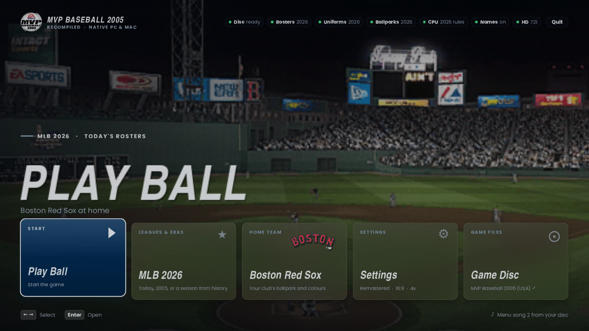
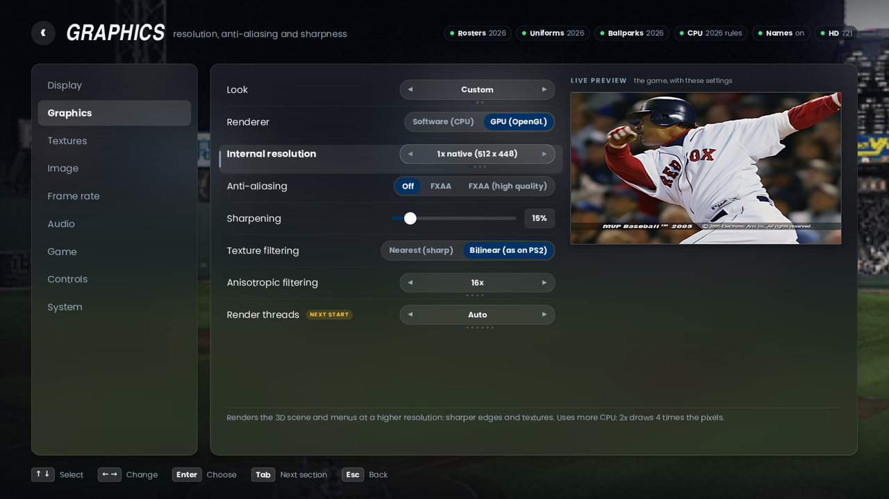

# MVP Baseball 2005 — native PC/Mac recompilation

A static recompilation of the PS2 game *MVP Baseball 2005* (USA, `SLUS_211.35`) into native C++.
You need your own copy of the game; no game code or assets are included or distributed.

**Status: you can play a match.** All ~29,900 functions of the game's main CPU code run natively. The
game boots from your ISO, plays its intro movies, goes through the memory-card check, title and menus (with
saves on disk), and Play Now runs a full game: team select, the Fenway intro, lineups, pitching, batting and
fielding. The game is drawn on your graphics card (Metal, Vulkan or OpenGL) at up to 4x resolution.

 

## Playing it

1. Download the build for your computer from the Releases page: **Mac** (Apple Silicon, macOS 11+), **Windows**
   (x64, Windows 10 1803+) or **Linux** (x64). Unzip it and start *MVP Baseball 2005*.
2. **Your disc.** The first start opens *Setup*. Choose a 1:1 `.iso` of your own *MVP Baseball 2005* disc, or drag it
   onto the window. **Only the USA disc works (NTSC-U, SLUS-21135)**: the game's code was recompiled from that one
   disc, so European or Japanese discs, other printings and modified images are turned away with the reason (the
   check compares the game program's checksum). `.chd` / `.cso` images have to be turned back into `.iso` first;
   Setup says how. Nothing else is needed: the disc image stays where it is and only the 8 MB game program is
   copied out of it.
3. **Features.** Setup then lists what can be added, with each one's download and disk size, the free space on
   the drive, and a preview (a before/after slider for the HD textures, a wall of the new portraits):

   | Feature | Size | |
   |---|---|---|
   | Today's rosters (2026) | 160 MB | every club's current players, managers, schedule; commentators say 850 new names |
   | Player portraits | 660 MB | a rendered portrait for every current player |
   | Today's uniforms / ballparks | 11 + 10 MB | the closest current uniforms; today's park names and fences |
   | 2026 rules for CPU play, varied head shapes | 4 MB | |
   | HD texture pack, 4x or 2x | 44 GB / ~12 GB | every texture on the disc redrawn (one or the other) |
   | Seasons from history | 0.3-0.7 GB each | 13 eras from 1910 to 2019, each its own league |

   The recommended ones are ticked. Install downloads them (it can be stopped and continued; every archive is
   checked against its SHA-256), unpacks them and turns them on. *Disc & Features* on the launcher's hub brings
   Setup back to add or remove features later; removing one turns its setting off again.
4. Press **Play Ball**.

Settings, saves and features live in the game folder: next to the program on Windows and Linux (unzip it
somewhere you can write to), `~/Library/Application Support/MVP Baseball 2005 Recomp` on a Mac. `MVP_HOME`
points it anywhere else.

**Launcher.** The game starts in a launcher laid out like a sports broadcast: your home team's ballpark from the
disc fills the window (it drifts slowly and fades into the game's other menu photos), with frosted-glass panels
over it and a row of tiles: *Play Ball*, *Leagues & Eras* (cards for today's game, the 2005 original, every era
pack, My League, and building a new season), *Home Team* (the 30 wordmarks: their park, wordmark and colours
theme both menus), *Settings* and *Game Disc* (Import game disc... opens a file dialog, or drag the .iso onto the
window; it checks that it's MVP Baseball 2005 USA and copies the game program to `game/`). Chips across the top
show what Play will load (disc, rosters, uniforms, ballparks, CPU play, commentary names, HD textures, your
music). The Display, Graphics, Textures and Image pages have a *live preview*: in the launcher your ballpark,
in the game the game itself shrinks into the card, drawn with the settings as you change them. Everything
eases: views slide and fade, selections glide, switches slide. Turn *Show this launcher at start* off to go
straight into the game; hold **Shift** while starting (or run with `--launcher`) to get it back. `--play` skips
it. On a Mac, `tools/make_app.sh` makes a double-clickable *MVP Baseball 2005.app* in the project folder.
Art comes from *your* disc at run time (nothing from the game is stored in this project); without a disc the
same layout appears without it. The in-game menu (F1) is the same hub over the paused game: Resume, Settings,
Leagues & Eras, Home Team, Screenshot, Quit.

**Loading.** The game starts on its title screen in a few seconds: the EA logo, a player cameo and the
minute-long intro movie are skipped (*Game Disc > Intro movies* brings them back), the 4-second black wait
before them is gone, and the disc module no longer waits 30 ms after every read for a drive that answers at
once (2.5 s at boot).

 

It opens a window (SDL2 + Metal / Vulkan / OpenGL) and is played with the keyboard or any gamepad. Press **F1** (or Esc,
or Back+Start on a gamepad) for the menu. It pauses the game and works with keyboard, gamepad or mouse:

| Section | Settings |
|---|---|
| Display | aspect ratio (4:3, 16:9, 16:10, 21:9, 32:9, match my display), window / borderless fullscreen / exclusive fullscreen, monitor, window size, scaling filter (nearest, bilinear, bicubic, auto = area-average when shrinking), integer scaling, VSync, interface size |
| Graphics | quality preset (Original, Performance, Balanced, Quality, Remastered), renderer (GPU / software), graphics API (Auto / OpenGL / Metal / Vulkan), internal resolution auto (fit the window) or 1x-6x (3072x2688 at 6x), anti-aliasing (FXAA, FXAA high quality), sharpening (AMD CAS), texture filtering, anisotropic filtering (2x-16x, GPU renderer), render threads |
| Textures | built-in HD upscaling (2x / 4x), texture packs, texture dumping |
| Image | brightness, contrast, saturation, gamma, retro effect (scanlines, or CRT with curvature and vignette) |
| Frame rate | limit 30-360, match my display's refresh rate, or unlimited; game timing (real-time / classic), frame skip, FPS counter (simple / detailed with frame-time graph) and its corner, pause in the background |
| Audio | volume, mute, music in the launcher, soundtrack (the game's songs / your music / both), import music |
| Home team | one of the 30 clubs (or none): themes the launcher and the menu |
| Game | rosters: modern (2026), original (2005) or a league pack; player portraits on/off; commentary names for new players on/off; CPU play: original (2005) or 2026 rules; uniforms and ballparks: original (2005) or today's |
| Controls / System | key and gamepad reference; save settings, intro movies, show the launcher at start, screenshot, reset, quit |

Settings apply immediately and are saved with System > Save settings to `mvp2005.ini` in the current folder.
Command line: `--widescreen`, `--aspect 0-5`, `--fullscreen`, `--res 2`, `--fps 120`, `--frameskip 1`, `--config file.ini`,
`--features [install|remove id...]` (the features without the launcher).

**Ultrawide.** Display > Aspect ratio goes past EA's hidden 16:9 mode: 16:10, 21:9, 32:9 or the shape of your
monitor. The two numbers EA's widescreen mode hard-codes, the cameras' 16:9 projection and the 4:3-to-16:9
horizontal factor its 2D layout uses, come from the setting instead (`tools/recomp/patches.txt`), so the field of
view widens with the screen and the score bug, lineups and menus keep their proportions. Full-screen photos in the
menus (the title screen) were drawn for 4:3 and stretch further at 21:9 and 32:9, as they already do at 16:9.
Hold **Tab** to fast-forward, **F12** saves a screenshot, **F2** cycles the FPS counter.

**Higher frame rates.** The game hard-codes a 1/60 s simulation step (771 places). The recompiler now routes
those constants through a runtime value, and *Game timing: Real-time* (the default) sets it from the
measured frame time. So 120 or 144 fps keeps normal game speed instead of running twice as fast, and a PC
that can't hold 60 no longer plays in slow motion. Physics, animation and camera use that step. Some menu
timers count frames and still run faster above 60 (for example the title screen's idle timer). *Classic*
restores the original fixed step.

**HD textures.** Graphics > Look: *Remastered* turns everything below on in one step (4x resolution, the pack,
built-in upscaling for what the pack lacks, 16x anisotropic filtering, FXAA, a little sharpening).
- *HD texture pack* (`textures/replace/`). The pack is built from the disc, not from what happened to be on screen:
  `tools/hd/extract_textures.py` reads every texture out of the game's archives (uniforms, heads, faces, equipment,
  all ballparks, crowd, menu art, logos; 3-bit "type 14" textures unpacked as the graphics chip would) and names each
  one the way the runtime will, including the textures the game only assembles while it runs: every jersey number
  and every player's name in his club's lettering. `tools/hd/build_pack.py` upscales them 4x with Real-ESRGAN
  (RealESRGAN_x4plus for players, uniforms and heads, realesr-general-x4v3 for the rest) and then repairs what an
  upscaler alone gets wrong: colour is pulled back to the original's, and the grain the model removed is measured
  and rebuilt at the new resolution, so dirt, grass, cloth and skin keep their texture instead of turning to
  plastic. Tiling textures stay seamless, cut-outs keep clean edges, and letters keep their outline.
  Work is ordered by how much a texture matters (tiers 1-5: today's uniforms and the players who wear them, heads
  on today's rosters, ballparks, then alternates, menu art, minor leagues, 2005-only content) and can be stopped and
  continued at any time; `--quick` uses the fast model everywhere first and a later run without it redoes only what
  the better model improves. Fonts and the few menu pieces that are not in the archives come from dumps
  (`--dumps textures/dump`). With onnxruntime installed the models run 3-4x faster (`tools/hd/onnx_export.py`
  writes them as ONNX without needing PyTorch).
  `tools/hd/finish_pack.sh [models folder] [tiers]` does all of it in one go and can be stopped and run again:
  ```
  tools/hd/finish_pack.sh ~/Downloads 1-3
  ```
  (by hand: `python3 tools/hd/extract_textures.py "game/MVP Baseball 2005 (USA).iso" game/hdpack mods`, then
  `python3 tools/hd/build_pack.py game/hdpack <models> textures/replace --tiers 1-3`).
  Colour comes from the original only: the models sharpen brightness well but overshoot in colour (the pale ring
  an artist's sharpening left around red chest lettering came back as vivid cyan), so every pixel keeps the
  model's brightness and takes its colour from the original texels around it. Textures built before this are
  repaired in place the next time the script runs (no model needed, a fraction of a second each).
  Brightness is held to what the original had around each spot (a pale one-texel highlight no longer becomes a
  white stroke). Grain is restored on everything that is not menu artwork: smooth photographs - faces, cloth,
  mown grass, painted walls - used to be taken for flat artwork and came out like plastic; textures built before
  this get their grain back in place, without the model, the next time the script runs.
  Wrapped padding (what keeps grass and brick seamless) is used only in the directions in which a texture really
  repeats: an outfield wall with a line along its foot used to get that line along its top as well.
  Letters get their own treatment: the shape of a letter lives in the alpha channel, and an upscaler run over
  that invents blotches in the thin shadows of small type. Clean on/off shapes go through the model, letters with
  shadows are enlarged and sharpened without moving their edges, glows stay smooth.
- *Built-in HD upscaling* (Textures > HD upscaling 2x/4x) upscales anything the pack doesn't cover on the fly
  (bicubic, alpha-aware, light sharpening).
- *Your own textures*: Textures > Dump textures saves every texture as `textures/dump/WIDTHxHEIGHT_hash.png`;
  put an edited or upscaled file with the same name into `textures/replace/`.
- Menu artwork and fonts are not power-of-two sized, and the unused rest of such a texture used to be hashed with
  it: whatever lay behind it in video memory, different from screen to screen. One font was dumped under hundreds
  of names and replaced only when the leftovers happened to match. The runtime now remembers how much of a texture
  was really uploaded and ignores the rest, so every font and menu image has one name and is always replaced.
  (Packs made before this keep working for everything else; their menu and font entries are no longer used.)
- *Alpha above "opaque".* A PNG's alpha of 255 stands for the graphics chip's 0x80. The scoreboard and name-plate
  fonts use the range above that (up to 0xff, drawn at half strength), which a doubled value cannot hold: their
  dumps were clipped and their replacements came out half as opaque as the original. For textures that go
  above 0xa0 the PNG now holds the chip's value as it is, in dumps and replacements alike.
- *Boxes around letters.* Two of the game's font pages fill the space between their glyphs with a faintly visible
  colour. At the console's resolution it only tints the outermost pixel of a letter; at 2x-4x, and after
  upscaling, it turned into a thin box around every letter of the menu text. The runtime and the pack tools now
  recognise that filler and make it transparent, and sprites at a higher internal resolution no longer sample
  past the texels the console itself would have read (`MVP_NO_TEXGUTTER=1`, `MVP_NO_SPRITE_CLAMP=1` switch the two
  off; at 1x nothing changes).
The game's FMV menu backgrounds are video and can't be replaced this way.

**Graphics API.** Graphics > Graphics API: *Auto* uses Metal on Macs with Apple chips and OpenGL elsewhere;
*Vulkan* works on Windows and Linux and, through MoltenVK, on Macs (`brew install molten-vk vulkan-loader
vulkan-headers shaderc` before `make`). All three draw the same picture (Metal and Vulkan screenshots: 99.6% of
pixels within 8/255, the rest edge rounding) and run at full speed on an M-series Mac. Metal blends exactly in the
shader (Apple GPUs read the pixel being drawn over), so it needs no target copies at all. Falls back to OpenGL when
the chosen API can't start; `MVP_GPU_API=gl|metal|vulkan` overrides the setting for one run. How it works and the
Direct3D 11/12 plan: [docs/renderers.md](docs/renderers.md).

**GPU renderer.** Graphics > Renderer: *GPU* is the default. The game's main 3D/UI picture is
drawn by your graphics card at the internal resolution, so 2x-4x cost almost nothing, and the CPU no longer
rasterizes it at all. The software renderer is still there (Renderer: *Software*) and is used for the small
render-to-texture targets (shadows, portraits) and whenever the GPU isn't available. The two produce
practically the same picture (checked pixel by pixel on recorded frames: >99.7% identical, the rest are
edge and rounding differences).

**Anti-aliasing.** Real supersampling: set Internal resolution to 2x-4x and Scaling filter to Auto. The
image is rendered at up to 2048x1792 and area-averaged down to your window. FXAA smooths remaining edges,
and sharpening restores crispness. Everything after the game image is done on the GPU (in the chosen API). The
SDL_Renderer fallback, used when no GPU API is available, has no post effects.

**Modern rosters.** Settings > Game > Rosters: *Modern (2026)* (the default when `mods/rosters-2026` is
there) or *Original (2005)*; restart the game after changing it. All 30 teams have their current big-league
players, and each organisation's AAA/AA/A teams have its current Triple-A, Double-A and High-A players
(2,820 players). Ratings come from real 2025-26 stats and Statcast data: contact and power against lefties
and righties, plate discipline, sprint speed, defence (Outs Above Average, arm strength), spray and batted-ball
tendencies, and for pitchers their actual pitch mix, velocities, control, strikeouts and stamina. Each
rating is mapped onto the distribution the 2005 database used, level by level (today's big-leaguers get the
ratings the game's big-leaguers had, AAA players those of its AAA players ...), so the game stays balanced. Lineups,
rotations and bullpen roles are set from those ratings. Managers are current. The Angels, Athletics,
Guardians, Rays and Marlins have their current names in the menus.
Player looks come from their official MLB headshots (`tools/faces/`, measurements only; no photo is put in
the game). The game has 15 generic heads, each a face texture with its own skin colour that the 2005 database
always pairs with one body tone, so the head is chosen first, from the measured skin lightness, and the body
follows: head and arms always match. Players born in Japan, Korea or Taiwan get the head EA used for East
Asian players. Facial hair is a full beard, a goatee, a moustache or none, as in the photo; hair colour is
measured from the hair that shows under the cap or from a full beard (black, dark brown, brown, light brown,
blond, red), and hair that reaches the collar becomes one of the game's long styles. What a photo can't show
(the hair style under the cap) is drawn from the 2005 players with the same kind of head. The small portrait
on the batter and pitcher cards is the game's own live render of that head, so it follows automatically.
Build (the game's skeleton/body profiles) is taken from the 2005 players closest in height
*and* weight, and hitters wear today's protective gear (elbow and leg guards on about 45% / 35% of them).
**Commentary names** (Game > Commentary for new players, on by default; `mods/commentary-2026`): the
commentators say the surnames of about 850 new players, using their real 2005 recordings of that surname from
the list the game itself uses to name its generated rookies (a new player who shares a full name with a 2005
player also gets the stadium announcer's clip). For surname-only matches the stadium announcer skips the name
instead of saying the 2005 player's first name. No new voice lines are synthesised.
The five clubs that changed their name are handled the same way, with recordings that are on the disc: where the
commentators said "Cleveland Indians", "the Indians" or "the Devil Rays" they now say "Cleveland" and "Tampa
Bay", and "Anaheim Angels", "Oakland Athletics" and "Florida Marlins" become "the Angels", "the Athletics" and
"the Marlins" (`tools/build_team_speech.py`; nobody recorded "Guardians", "Rays" or "Miami"). A few sentences
lose their lead-in that way. The stadium announcer skips those five team names.
Limits: real faces aren't modelled (the game only has heads for 2005 players), about 1,950 new players have
surnames that were never recorded and aren't named by the commentators, the logos in the menus are still 2005
ones (uniforms and ballparks: see below), the minor-league teams keep their 2005 names, and Houston stays in the
NL Central (moving it would break the 2005 schedule). Franchises and rosters saved on your memory card keep
the rosters they were made with.
**Lineups.** Each club's nine are the players worth most together with every one at a position he plays (an
assignment over bat, glove and how much he has played there), then a batting order: on-base and speed first, the
best hitter second, power fourth. Before, positions were filled one at a time with the best bat left, and a
position a player never played cost him little: Soto at second base, Trea Turner at DH behind a second baseman
at short, Ohtani at first with Freeman the DH. Nobody has DH as his position any more (the 2005 database has no
such player either: it is a second position); a staff has five starters before the best arms left are added.
**Who makes the 25, and free agents.** A club's 25 are the players it used: time played in the majors counts
next to the rates (a call-up with thirty good plate appearances no longer takes an everyday player's place). The
game's free-agent pool - 39 unsigned players of early 2005 on two hidden teams - is replaced by big-leaguers of
the season who did not get a place on their club or its AAA team here (`rosters_summary.txt` lists them first),
then by the best of the remaining minor-leaguers, so that none of 2005's is left to be signed at 58;
the game fills the rest of the list with made-up players, as it always did. A club's 13 hitters include at
least four outfielders and five infielders.
**Simulated seasons.** A season simulated with the 2005 rosters scores 4.4 runs a game, its best starters have
ERAs of 2.3 and its best base stealers 35 steals at the all-star break. The first modern database gave 3.6 runs,
five starters under 1.70 and nobody with 20 steals, and three Rockies farmhands led the batting race. Four
things were wrong, and a season is now simulated after every change to check them:
- one percentile mapping over all levels gave the big-leaguers the top of every scale (the 2005 database is not
  that steep), which helped pitchers more than hitters: ratings are now mapped level by level;
- the game rates a fastball by its velocity, and its own big-leaguers threw 92 mph on average, today's 95: the
  roster builder writes the constant that puts the average fastball back where it was (`sim.txt`; the pitches
  themselves keep their real speeds);
- minor-league lines were translated too kindly (AAA hits x0.955): now AAA hits x0.90, home runs x0.74, walks
  x0.85, strikeouts x1.18, steeper below, and every line is corrected for where it was put up (Coors Field,
  Albuquerque, Reno ... from the club's hitters and the hitters its pitchers faced). The minors also run far more
  than the majors, so steals are translated too: the top stealing ratings had all gone to farmhands;
- stolen-base attempts in simulated games are a third more frequent under the 2026 rules (bigger bases, pickoff
  limit), as they are in real games (one constant, `tools/recomp/patches.txt`).
With all four, on 31 July of a simulated 2027 (104 games): 4.6 runs a game with the DH in both leagues, Cole 1.96
and Skubal 2.27, Moniak 36 home runs and Ohtani 31, Chandler Simpson 47 steals and Witt 32, a .358 batting leader.
**The league of each season.** The game's simulation gave every year the same league, about .280 with 19%
strikeouts, in 1977 as in 2027. Now (Settings > Game > Simulated games) each outcome of a simulated plate
appearance is scaled to the real major leagues of the season being played (`mods/league_rates.txt`, 1871-2025),
and steered by the season's own statistics as it goes: a simulated 1977 hits .259 / .322 / .393 with 13.4%
strikeouts (real: .262 / .326 / .398, 13.5%). Who hits for average or power still comes from the ratings.
Base running follows real rates too: the game sent a runner by his speed against a fixed line (31% scored from
second on a single, 10% from first on a double); now it is a chance that grows with speed (62% and 43%, real
about 60% and 40%), and there are fewer double plays and more runs scored on outs with a runner on third.
Pitches get away now and then (the simulation never threw a wild pitch): with runners on, about 0.45 wild
pitches and passed balls a team game (0.6 before 1920), every runner moving up a base. And fielders boot ground
balls as often as the season's real ones made errors (from 1.8 a team game in 1910 to 0.6 today): the batter is
safe at first and the runs that follow are unearned.
**Deliveries.** Pitchers throw from their real arm slot: Statcast's arm angle picks the game's sidearm motion
(Tyler Rogers, Tim Hill, Hoby Milner ...), its low three-quarter one, or one of the seven ordinary ones. Before,
a new pitcher got the delivery of a random 2005 pitcher: one in sixteen threw sidearm and a few had Randy
Johnson's or Dontrelle Willis's motion. (`tools/fetch_mlb_data.py` now also writes `mvp_armangle_<season>.txt`.)
**The year.** The game's calendar starts in 2005 and nothing on the disc says so in one place: the year is written
into 63 instructions (start dates, "is this the first season", contract years counted from 2004, the schedule
picked by year, the birth years Create Player offers, the last year of a dynasty). With the modern rosters the
runtime moves all of them, and the year of every date the game converts, by the same amount
(`tools/recomp/years.txt`, `wraps.txt`; the amount comes from `mods/rosters-2026/year.txt`). A dynasty then starts
in the spring after the rosters' season - 2027 for rosters fetched at the end of 2026, the way the game itself
shipped before the 2005 season with 2004 as last year - with the right weekdays, ages, birth dates and contract
years. Inside, the game counts the same days it always did, so nothing else about a dynasty changes; with the
original rosters the year stays 2005. One oddity: 29 February turns up in the years the game's own calendar had
it (2030, 2034, ... instead of 2028, 2032).
The year-by-year lines on the player cards (`DATA/DATABASE/HIST.DAT`) are rebuilt too: the last two real seasons,
under their real years. This file matters more than it looks. The game keeps one table entry per player named in it
(room for 3750) and with the 2005 file its 1,200 departed players used up the room the new ones need: a dynasty
froze for good while simulating its seventh day or so. A dynasty started with rosters built before this fix carries
the full table in its save and still freezes; start a new one.
To refresh the rosters later (e.g. next season), on your Mac:
```
python3 tools/fetch_mlb_data.py 2026             # current rosters + stats from MLB's public stats sites
python3 tools/build_rosters.py "game/MVP Baseball 2005 (USA).iso"   # writes mods/rosters-2026
```
Nothing on your ISO changes: the runtime serves the new database in place of the disc's copy.
`mods/<name>/` mirrors the disc's folders (`--mod dir` loads extra ones): a file replaces the disc's file; a
folder named like one of the disc's BIG archives (`mods/x/DATA/MODELS.BIG/u005a.ssh`) replaces single members
of that archive without copying it; `strings.txt` (`2005 text<TAB>new text`) changes text in the game's string
tables. Files are read when the game asks for them, not loaded at start.

**CPU play: 2026 rules** (Game > CPU play, on by default; `mods/ai-2026`, built by `tools/build_ai.py` from the
game's own tuning file on your disc). How computer-controlled teams play follows today's rules:
- no extreme infield shifts (banned in 2023): the two "extreme shift" alignments, which put three infielders
  on one side of second base, become the strongest legal shade (two on each side, all on the dirt);
- pitch clock: CPU pitchers take 40% less time between pitches;
- bigger bases and the pickoff limit: CPU managers send fast, skilled base stealers more often, and a
  left-handed pitcher holds them less;
- the hit-and-run, nearly gone from today's game, is called about half as often;
- more stolen-base attempts in simulated games too (see *Simulated seasons*), and pitchers taken out earlier
  there (they tire a fifth faster and are pulled a little sooner): a 2027 season simulated with 2005 habits had
  a starter with 245 innings and 12 complete games, now the leaders have about 220 and 4;
- the designated hitter in every park (universal DH, 2022): with the game's own DH Rule option at its default,
  both clubs use their DH lineups wherever they play (one patched instruction, `tools/recomp/patches.txt`; the
  option's other settings still work, and this one does not need `mods/ai-2026`).
When the CPU changes pitchers, pinch-hits, bunts or walks a batter intentionally is decided by compiled code and
works as in 2005, and the game has no extra-inning runner or three-batter minimum.

**Your own music** (Audio > Import music..., or drag songs onto the window; `mods` are not involved). The game's
menu soundtrack is nine songs on the disc in EA's own stream format (EA-XA ADPCM, 32 kHz stereo). Importing a
song converts it once to exactly that format (a few seconds per song; kept in `music/`), and with *Soundtrack:
My music* the game gets your songs in place of its nine (more than nine: a different nine at each start; *Both*
keeps some of the game's). The game plays them itself, so its "EA SPORTS TRAX" display and jukebox work and show
your song names; name a file `Artist - Title` to fill both lines. The launcher plays them too. On a Mac, MP3,
M4A/AAC, FLAC, AIFF and WAV are read with the system's own converter (afconvert); elsewhere WAV is read directly
and other formats need ffmpeg installed. From a terminal: `./build/mvp2005 --music-import song.mp3 ...`
(`--music-export music/x.asf out.wav` decodes one again). *Remove my music* deletes only the converted copies.

**Uniforms: today's looks** (Game > Uniforms, on by default; `mods/uniforms-2026`, built by
`tools/build_uniforms.py` from the uniform textures on your disc). Every club in the game has a wardrobe: home,
road, alternates and throwbacks. Nothing new is painted; the default home and road sets are re-chosen and
recoloured from that wardrobe so they are as close as it allows to what the club wears now:
- throwback sets that are today's look again: Blue Jays (the classic bird and split lettering), Astros (navy and
  orange, the H-star cap), Brewers (ball-in-glove cap, pinstripe alternate), Reds (no black, no vest), Twins and
  Mets (no pinstripe-era black), the Orioles' cartoon-bird caps, the Royals' powder blue alternate;
- new colours by recolouring the palettes: Rays navy, Padres brown and gold, Diamondbacks red, Marlins blue;
- jerseys that fit the club's name today: Cleveland wears the block CLEVELAND set on white and on grey with the
  plain "C" cap (no Chief Wahoo), the Athletics' and Marlins' road jerseys carry the team name instead of
  "Oakland" / "Florida".
The jersey thumbnails in the uniform menu follow, and so do the logos in the menus and on the in-game cards:
recoloured for the recoloured clubs, and Cleveland's are the block "C", cropped from that 1970s cap's texture
(the launcher's Home team page shows them too). The same "C" replaces the 2005 logo where it is painted in
Cleveland's park: the outfield wall, the banners on the upper deck and the concourse signs (the "Indians" script
on the scoreboard is signage like the old park names, and stays). Limits: no current logo or wordmark is drawn, so scripts and
cap logos are 2005's or older even where a club has redesigned them (the Marlins' cap still shows the "F"
marlin, the Rays' and Padres' wordmarks are the 2005 ones in new colours); the throwback slots keep their art.

**Ballparks: today's names and fences** (Game > Ballparks, on by default; `mods/stadiums-2026`, built by
`tools/build_stadiums.py`). The parks carry their current names in the menus and on the pre-game overlay, and
the outfield is reshaped where the fences have moved since 2005 (T-Mobile Park, Comerica Park, Kauffman Stadium
2026, Petco Park, Oracle Park, Daikin Park without Tal's Hill) or the club has moved (Athletics, Rangers, Twins,
Cardinals, Braves, Marlins, Nationals, Mets get today's park name and fence distances). A stadium in this game
is a set of models with plain floating-point vertices in inches around home plate, plus text files for walls,
collision, shadows and the crowd; the tool moves everything from the outfield grass outwards by the change in
fence distance at that angle, so fence, warning track, stands and collision walls stay together and the infield
is untouched (`mods/stadiums-2026/stadiums_changes.txt` lists before and after for every park). Limits: the
buildings are the ones the game shipped with (the Twins still play under the Metrodome's roof, whatever the sign
says); wall heights and the distance numbers painted on the walls are 2005's. Nobody recorded today's park
names, so the commentators no longer name the 15 renamed parks at all (they used to welcome you to Jacobs Field).

**Movies.** The intro and menu movies play with sound (the PS2's MPEG decoder, the IPU, is emulated; see
`research/notes/findings.md`, session 12). Press START to skip them, as on the console.

**Not done yet** (honest list):
- **Sound**: music, crowd, commentary, movie audio (mixed by the game itself) and sound effects (a 48-voice
  SPU2 ADPCM engine) play through SDL at 48 kHz. Volume and mute are in the Audio tab. Reverb isn't
  emulated, but the game never turns it on (its reverb mode stays 0 in the intro, menus and matches).
  Left and right were swapped for everything the game mixes itself until this was checked against the game's
  sound driver; they are the right way round now.
- **Speed**: the VU1 vector unit's hot microcode loops are precompiled to C++ (generated/vu1_blocks_*.cpp),
  the rest is interpreted; VU1 is still the biggest CPU cost. The game's frame-sync loop no longer spins: it
  sleeps until the next interrupt or graphics event (about a fifth less CPU at full speed). The game keeps
  most textures compressed and has the graphics chip unpack them again every frame (about 20 per frame in a
  match); a dedicated routine does that now instead of the general rasterizer (software drawing of a match is
  about 17% faster, and the unpacked textures can be cached, HD-upscaled and dumped like any other). Skipped
  frames (Frame skip: Auto) only drop what is drawn into the picture; anything drawn into texture memory still
  happens. The same compressed textures come back every frame, so the unpacked result is now kept by content
  (99.9% of unpacks in a match are a copy of a kept result: 15% of the main thread down to 2-3%). The draw state
  of a triangle strip (registers, palette, texture) is prepared once per strip instead of once per triangle,
  microcode that is loaded again is only looked at where it really changed, and the compiled VU1 blocks keep
  their bookkeeping in registers (6 ns per instruction pair instead of 9). A match that ran at about 55% speed
  in the test machine's software renderer now holds 90-100%. Only measured in a slow 2-core cloud VM so far,
  not yet on a real Mac.

**Depth of field.** In batter walk-up shots the game blurs the background behind the batter. That effect used
to show as coloured noise over the grass, the wall and the crowd (the blur layer was drawn from memory that the
game never filled; see findings, session 17). The renderer now makes the half-size copy of the picture the
layer needs, so those shots have their soft background. `MVP_NO_DOF_FIX=1` shows the old behaviour.

## Portraits, league packs, eras, custom clubs

**Player portraits.** Every big-leaguer gets a portrait of his own, rendered by the game itself: his face (with
the HD face textures), his club's cap and jersey, lit in the Edit Player studio at 4x resolution, cut out and
framed like the game's photos. They show on the roster screens and the in-game cards; with HD textures on, at
512 x 512. `tools/portraits/capture.py` takes the pictures from a running game, `tools/portraits/build.py` makes
`mods/portraits-2026` (new members of PORTRAIT.BIG, their HD versions, and which player each belongs to).
Settings > Game > Player portraits.

**A face of his own.** The game has 504 real 2005 faces and 15 generic ones; every newer player used to share
the generic ones. `tools/faces/facegen.py` takes the disc's faces apart (bald faces, hair and beard layers, the
features of the 291 real faces that share the generic layout) and makes a new face per player from his skin tone,
hair colour and style, facial hair and age, with features blended from two or three real faces, greying and
creases with age, stubble, eye colour; at 2x and 4x from upscaled pieces for HD textures.
`tools/faces/build_faces.py` gives every big-leaguer and AAA player of a league one (the modern rosters and every
era pack ship with them). `tools/faces/photo_faces.py PHOTOS MOD WORK` puts photos you supply (named after the
player, front-facing) onto his face.
**Portraits drawn by our own renderer.** `tools/portraits/render.py` redraws the game's own close-up of a head
(its triangles, recorded once for each of the 15 heads x 5 hair shapes: `tools/faces/record_templates.py`) at 4x with
filtered textures and studio light; `tools/portraits/render_league.py` draws every player of a league that way
with his made face, his club's (era) cap and jersey upscaled, and his skin tone, so every league gets portraits
(`mods/<pack>/portraits`) without capturing each player in the game. `tools/faces/make_all.sh` does faces and
portraits for every pack. The game's 15 generic heads are given more varied jaws, cheekbones and chins
(`tools/heads/head_shapes.py` -> `mods/heads`, Settings > Game > Varied head shapes), and the portraits are
drawn from heads recorded with that setting on, so a player's portrait matches his head on the field.

**League packs** (`docs/league_packs.md`). A whole league as spreadsheet files: clubs, players, depth charts,
managers, last season's stats, the first season. `tools/leaguepack.py export` writes one from any database (the
modern rosters export and build back byte for byte), `build` makes the mod; clubs can be renamed and given their
own logos and colours (PNG files named in teams.csv), and get complete uniforms made for them
(`tools/uniform_maker.py`: jerseys, pants, caps, helmets, numbers and letters, on the cut of one of the game's
own sets). Pick a pack under Settings > Game > Rosters.

**Eras** (launcher > Eras: every pack with a few lines about its season; pick one and start a New Dynasty, or build
any season 1901-2025 from there). Packs for 1910, 1927, 1941, 1951, 1961, 1969, 1977, 1986, 1993, 1999, 2004, 2012
and 2019 come built. `tools/eras/build_era.py ISO LAHMAN_DIR 1976` makes the major leagues as they were after a season from
the Lahman Baseball Database (free, CC BY-SA, sabr.org): every club in its franchise's slot (Expos for the
Nationals, Brooklyn for the Dodgers, Senators for the Twins ...), the players rated from their real lines, the
managers, and farm systems with the prospects who reached the majors in the next five years. Every later
big-leaguer comes in the draft class of about the year he turned 21, so history arrives on schedule (Ripken,
Gwynn and Boggs in the early classes of a 1977 start). Clubs that began the next season (Seattle and Toronto in
1977) get their first real rosters; franchises that did not exist yet are expansion clubs. The calendar starts in
that year, and simulated games play like each season as the dynasty goes on (see *The league of each season*).
Clubs wear what they wore then, where the game's wardrobe has it (`tools/eras/era_uniforms.py`: the Astros'
rainbow, the Expos, the Pilots, the Brewers' and Royals' powder blue, Brooklyn, the New York Giants, the Browns ...;
22 of 1977's clubs), and the looks follow the dynasty: when a 1977 dynasty reaches 1983 the clubs wear 1983's
(the runtime reads the season off the schedule and refills those members of MODELS.BIG from the disc,
`mods/<pack>/uniform_years.txt`). Names follow too: in a 1951 dynasty the Braves move to Milwaukee in 1953, the
Browns become the Orioles in 1954, the Dodgers and Giants go west in 1958 and the minor-league stand-ins turn into
the expansion clubs of their first season, and clubs play in the park they had that season (Crosley Field until 1970, then Riverfront; `park_years.txt`), with logos for each name (`tools/eras/era_teamnames.py` ->
`team_years.txt`, `tools/eras/era_logo_years.py` -> `mods/era-logos`; the dynasty's save keeps the new names). Draft classes are ranked by the careers that followed and given the rookie generator's star
level to match (`tools/eras/draft_potential.py`), and the made-up rookies the game adds around them get none, so
the real players lead the draft board. Clubs play in the old parks the disc has (`tools/eras/era_parks.py`: Tiger
Stadium, Veterans Stadium, the Astrodome, Riverfront, Cleveland Stadium, Metropolitan Stadium, Olympic Stadium,
Jack Murphy; the Polo Grounds, Forbes, Shibe, Crosley, Griffith and Sportsman's for earlier starts), and salaries
are at the season's money (`tools/eras/era_money.py`). Clubs that are not the 2005 club of their slot (the Kansas
City A's, the Expos, the Browns, the Pilots ...) get plain logos of their own: initials and names in their uniform's
colours, no historical marks copied (`tools/eras/era_logos.py`). Franchises that did not exist yet are named for a real minor-league club
of their city in those years (`tools/eras/era_names.py`: the Seattle Rainiers, Houston Buffaloes, Montreal Royals,
Toronto Maple Leafs, Denver Bears, the Pacific Coast League's Los Angeles Angels and San Diego Padres ...) and wear
plain flannels in their colours with their name across the chest (`tools/uniform_maker.py`). The commentators call each club by what they recorded that fits (the Kansas City A's "the Athletics", the Seattle Rainiers "Seattle") and skip the name of a club they never recorded (`tools/eras/era_speech.py`). Every club of every level
meets the game's roster rules (25 / 25 / 22 / 22 players, five starters and a closer, ten fielders, a catcher;
`tools/eras/fix_rosters.py`), so a dynasty never stops on a roster message, and `tools/eras/check_pack.py PACK`
checks a pack for all of this. Under an era pack today's uniforms and ballparks
(Settings > Uniforms / Ballparks) are left out so they do not cover the season's, and the DH follows the season:
none before 1973, the AL's only until 2022. Seasons before 1961 are 154 games (`tools/eras/era_schedule.py` takes eight games from every club of the
game's 162-game schedules, four at home and four away, spread over the season). Built: 1910, 1927, 1941, 1951, 1961, 1969, 1977, 1986, 1993, 1999, 2004, 2012, 2019.

**Head shapes** (`tools/heads/head_shapes.py`, Settings > Game > Varied head shapes). The game's 15 generic heads
were nearly one shape under 15 skins; now each has its own jaw width, cheekbones, lower-face length and chin. Only
the face below the eyes moves (caps, helmets and the neck joint fit as before). The head models' format is in
research/notes/findings.md (tools/heads/ordmesh.py reads and writes vertex positions).

**Team Maker** (`tools/teammaker/team_maker.html`, runs in a browser). Design a club: name, colours, a logo
(badge, monogram, emblem, ring lettering, or your own PNG), cap, jersey wordmark, home and road uniforms, and a
ballpark (a name, one of the game's parks old or new to build on, and your own fence distances); it saves a team
file. Put the team files in the `teams` folder of the game folder and press **Build My League** on the Eras page
(launcher or F1 menu): `tools/custom_league.py` puts every one into today's rosters (faces, portraits and
commentary names come along) as the league pack "My League", which the same page then offers. (By hand:
`tools/leaguepack.py add-team PACK team.zip`.)

## Layout
```
tools/recomp/ee_recomp.py   EE -> C++ recompiler (function discovery, delay slots, jump tables)
tools/recomp/overrides.txt  guest functions replaced by native code
tools/recomp/waitloops.txt  the game's busy-wait loops (they sleep instead of spinning)
tools/eedis.py              disassembler / xref helper
tools/extract_iso.py        pulls SLUS_211.35 out of your ISO
runtime/include/ee_ops.h    instruction semantics (macros used by generated code)
runtime/src/ee_kernel.cpp   HLE PS2 kernel: threads (coroutines), semaphores, interrupts, alarms
runtime/src/ee_hw.cpp       hardware registers, DMA, COP0, MMI/VU0 macro instructions
runtime/src/iop_hle.cpp     I/O processor emulation: SIF command/RPC protocol, reply delivery
runtime/src/iop_servers.cpp native IOP servers: loadfile, iopheap, cdvd (init/scmd/ncmd/search), fileio, pad, mc
runtime/src/iso.cpp         ISO9660 reader for your disc image; mods/ overlays replace disc files
tools/fetch_mlb_data.py     downloads current MLB rosters/stats/Statcast data (game/rosters/)
tools/build_rosters.py      turns them into the game's database + team names (mods/rosters-2026/)
tools/build_team_speech.py  the commentators' names for the renamed teams (mods/commentary-2026/); tools/utk.py decodes the game's speech
tools/faces/                measures looks from headshots (skin tone, facial hair, hair colour and length)
tools/build_ai.py           "2026 rules" CPU tuning (mods/ai-2026/); tools/datafile.py reads EA's tuning file
tools/build_uniforms.py     today's uniforms from the game's wardrobe (mods/uniforms-2026/); tools/ssh.py reads and writes shape files
tools/build_stadiums.py     today's park names and outfield dimensions (mods/stadiums-2026/)
tools/mvpdb.py, refpack.py, bigfile.py, loc.py   EA database tables, RefPack compression, BIG archives, LOC strings
runtime/src/gs_dma.cpp      VIF1 state machine (UNPACK, MPG, MSCAL, I-bit stalls) + DMA chains for VIF1/GIF
runtime/include/vu1_core.h  VU1 state, per-instruction handlers and step() (shared with the generated blocks)
runtime/src/vu1.cpp         VU1 microcode interpreter: pre-decoded pairs, Q/P and flag latency, XGKICK -> GS
runtime/src/gs.cpp          GS: GIF parsing, swizzled 4 MB VRAM, transfers, multi-threaded software rasterizer, PNG dumps
runtime/src/gs_gpu.cpp      GPU renderer: batching shared by all APIs + the OpenGL 3.3 backend (GS blending/tests in shaders)
runtime/src/metal.mm        Metal renderer + presenter (macOS, Apple GPUs; exact blending with framebuffer fetch)
runtime/src/vulkan.cpp      Vulkan renderer + presenter (Windows, Linux, macOS via MoltenVK); shaders in runtime/src/vk/
runtime/src/ipu.cpp         IPU (MPEG-2 macroblock decoder) for the movies: VDEC/FDEC/BDEC/CSC, toIPU/fromIPU DMA
runtime/src/iop_snd.cpp     EA SND driver replacement (bank uploads, driver tick, command-block exchange)
runtime/src/snd_mix.cpp     sound: driver ticks, EA SND blocks, SPU2 voices, SDL audio output
runtime/src/iop_pad.cpp     controllers (DualShock 2 incl. pressure buttons); scripted input for testing
runtime/src/iop_mc.cpp      memory cards backed by folders (memcards/slot1, memcards/slot2)
runtime/src/frontend.cpp    SDL2 window, input, launcher and pause/settings menu, overlays (headless if SDL2 is missing)
runtime/src/game_art.cpp    reads art from the disc for the menus: BIG archives, RefPack, EA shape files (incl. the 3-bit type 14)
runtime/src/menu_music.cpp  streams the game's menu songs and your imported ones (EA-XA .ASF) in the launcher
runtime/src/music_import.cpp custom music: WAV reader, resampler, EA-XA encoder, .ASF writer, song slots and names
runtime/src/loc_patch.cpp   the game's string tables (LOC): strings.txt replacements from mods
runtime/src/present_gl.cpp  OpenGL presenter: FXAA, resampling (area/bicubic), CAS sharpening, colour, CRT, UI
runtime/src/present_sdl.cpp SDL_Renderer fallback presenter
runtime/src/ui.cpp          UI drawing (rounded panels, images, anti-aliased text from tools/make_ui_font.py)
runtime/src/png.cpp         PNG reader for texture packs
runtime/src/settings.cpp    settings file + real-time simulation step
runtime/src/hle.cpp         native replacements for a few guest functions (kernel patching, printf)
runtime/tests/test_ops.cpp  instruction unit tests
generated/                  output of the recompiler (not checked in)
research/                   reverse-engineering notes, symbols, PCSX2 patches
game/                       your SLUS_211.35 (not checked in)
```

## Build (macOS)
```
xcode-select --install                     # once: compilers
brew install sdl2                          # once: window + controllers (without it: headless build)
brew install molten-vk vulkan-loader vulkan-headers shaderc   # optional: the Vulkan renderer (Metal is always built)
python3 tools/extract_iso.py "MVP Baseball 2005 (USA).iso"   # only if game/SLUS_211.35 is missing
make -j8                                   # ≈1–2 min (makes the C++ in generated/ first, and again whenever
                                           #  tools/recomp/ changes; by hand: python3 tools/recomp/ee_recomp.py)
make test                                  # instruction tests
./build/mvp2005 --iso "/path/to/MVP Baseball 2005 (USA).iso"
```
(or put the ISO at `game/MVP Baseball 2005 (USA).iso` and just run `./build/mvp2005`)
Linux: same commands (`apt install libsdl2-dev libvulkan-dev`). Windows: MSYS2 (UCRT64) with
`pacman -S mingw-w64-ucrt-x86_64-{gcc,cmake,ninja,SDL2,vulkan-headers}`, then
`cmake -S . -B out -G Ninja -DCMAKE_BUILD_TYPE=Release && cmake --build out`. Vulkan needs only its headers: the
loader is opened at run time, so a PC without a Vulkan driver falls back to OpenGL instead of failing to start.
The downloads on the Releases page are made by `.github/workflows/build.yml`; `docs/release.md` has the steps.
Debug builds: `make OPT="-O1 -DEE_TRACE"` records recent guest functions and prints them on a crash.

## Controls
| PS2 | Keyboard | Gamepad |
|---|---|---|
| D-pad | Arrow keys | D-pad |
| Left stick | I J K L | Left stick |
| Cross / Circle / Square / Triangle | Z / X / A / S | A / B / X / Y |
| L1 / R1 / L2 / R2 | Q / W / 1 / 2 | Bumpers / triggers |
| START / SELECT | Enter / Right Shift | Start / Back |

F1/Esc opens the settings menu (pauses; Quit is in there), F2 FPS counter, F11 fullscreen, F12 screenshot,
Tab (hold) fast forward. `--widescreen` turns on EA's hidden 16:9 mode (proper 16:9
cameras and HUD, confirmed in PCSX2 earlier) and shows the picture at 16:9. Optional code patches like
this live in `tools/recomp/patches.txt`.
Run with `--headless` for no window.

## What you'll see in the terminal
```
[iop-bind] bind 80000592 (cdvd-init) ...        IOP services answering
[cdvd-read] read lbn=16 n=1 -> 0093ed40          the game reading its own disc
[game] LgKbM library version 1.05.01 ...         the game's own printf output
[thread] CreateThread -> 2 ...                   game threads running
[syscall] SetGsCrt(interlace=1, mode=2, ...)     NTSC video mode set
[GIF] start ... / [VIF1] start ...               first graphics DMA: end of Stage 2
```
Press Ctrl+C to stop; it prints the thread states and recent guest functions.

To see frames: `mkdir frames && MVP_FRAMES=frames ./build/mvp2005 --iso ...` writes every 30th
displayed frame as `frames/frame_NNNNN.png` (plus every render target on exit).
Scripted input for headless testing: `MVP_INPUT="3000:START,3330:DOWN,3400:CROSS"` presses buttons at
the given game frame for 20 frames (timings shift with speed settings, so check the frame dumps) (names: START SELECT CROSS CIRCLE SQUARE TRIANGLE L1 R1 L2 R2
L3 R3 UP DOWN LEFT RIGHT, combine with `+`). Saves go to `memcards/` (override `MVP_MEMCARDS=dir`).
`MVP_AUTOPRESS="NONE=100,105,a99857;CROSS=!0,0,ff00ff"` (with `MVP_FRAMES`) looks at every dumped frame and presses
the button of the first rule whose pixel tests all hold (`x,y,rrggbb` is about that colour, `!x,y,rrggbb` is not;
`MVP_AUTOPRESS_FROM=frame` starts later): enough to let a dynasty simulate a whole year unattended, answering
the injury and rain-out dialogs.

Renderer testing: `MVP_GSREC=file.gsr MVP_GSREC_FRAME=n` records one frame of GS input; `mvp2005 --gs-replay
file.gsr out.png` re-renders it deterministically (`MVP_REPLAY_RES=2` at 2x, `MVP_GS_THREADS=0` single-
threaded, `MVP_REPLAY_GPU=1` with the GPU renderer in a hidden window). `MVP_FORCE_GPU=1` uses the GPU
renderer in headless runs too (hidden window); `MVP_OWNLOG=1` logs GPU read-backs, `MVP_IPULOG=1` IPU commands. `tools/vudis.py` disassembles VU1 microcode snapshots (`MVP_VU1SNAP=frame`).

Texture unpacking: `MVP_NO_DECFAST=1` uses the general rasterizer, `MVP_DECCHECK=1` compares every unpacked
texture with it (mismatches are counted at exit), `MVP_DECLOG=1` logs the targets, `MVP_SKIP_ALL=1` restores
the old frame skip (drops every draw), `MVP_SPIN=1` the old spinning wait loop.
Finding out what a frame does: `MVP_GSTRACE=1` prints one line per run of primitives with the same target and
per upload (best with `--gs-replay`), `MVP_GSLOG_TBP=addr` (+ `MVP_GSLOG_TBW=n`) logs primitives that use a
texture, `MVP_PICSRC=1` logs copies of the picture into texture memory and uses of them, `MVP_VWATCH=lo-hi`
logs writes into a VRAM range, `MVP_GSREC_DOF=n` records the frame n frames after the blur layer first appears,
`MVP_REPLAY_PRE=file` replays another recording first, `MVP_REPLAY_BUF=bp,bw,w,h,name` dumps a 32-bit buffer
before and after a replay, `MVP_FRAMES_FROM=n` starts frame dumps at game frame n.

Performance / rendering switches: `MVP_GS_THREAD=1` (experimental: VIF1/VU1/GIF on their own thread),
`MVP_GS_THREADS=n` rasterizer threads (default: cores-1, max 8;
0 = draw on the main thread), `MVP_FPS=1` prints speed every 300 frames, `MVP_TURBO=n` runs the vblank
clock n times faster (testing only), `MVP_DRAW_ALL=1` / `MVP_DRAW_FROM=frame` draw every frame in headless
runs, `MVP_PROF=file` (Linux) samples the host PC, `MVP_BIGTRI=frame` / `MVP_PROBE=x,y` log primitives,
`MVP_TIMING=1` times VU1 / GS / rasterizer calls for the totals printed at exit (off by default: reading the clock
that often cost 2%), `MVP_NO_DECCACHE=1` / `MVP_NO_PREP=1` switch off the kept texture unpacks / the per-strip
draw state, `MVP_DECCHECK=1` checks every fast unpack against the rasterizer,
`MVP_GSHAZ=1` logs render-to-texture drains, `MVP_VU1DUMP=dir` / `MVP_SNDDUMP=dir` dump microcode / sound blocks, `MVP_WAVOUT=file.wav` records the
audio output, `MVP_SPUDUMP=file` saves SPU RAM at exit, `MVP_NO_AUDIO=1` disables the audio device.

**Precompiled VU1 blocks.** A block is a straight run of VU1 instruction pairs up to the delay slot of the
first branch (or the E bit), found by a hash of its instruction words, so it works wherever EAGL loads the
microprogram. `generated/vu1_blocks.txt` lists the blocks seen while playing; turn it into C++ with
`./build/mvp2005 --vu1-gen generated/vu1_blocks.txt generated` (writes `vu1_blocks_0..7.cpp` and
`vu1_blocks_table.inc`), then rebuild (`touch runtime/src/vu1.cpp` the first time so it picks up the table).
Blocks not in the list are interpreted, so a missing or stale list is only slower, never wrong.
`MVP_VU1BLOCKS=file` records blocks while playing (append new ones to the list), `MVP_VU1CHECK=1` runs every
compiled block against the interpreter and counts mismatches (printed at exit), `MVP_VU1_NOBLOCKS=1`
disables them. `MVP_VU1REC=file` (with `MVP_VU1REC_FRAME=n`, `_RUNS=k`, `_EVERY=m`) saves the complete input of
microprogram runs while playing; `./build/mvp2005 --vu1-bench file [passes]` plays them back without drawing and
prints the time per instruction pair and a checksum of everything the programs left behind, which must not
change when the VU1 code is made faster. The block files are compiled with strict aliasing (they only touch
the VU state through its own types), everything else without.

Mods: `MVP_OVLLOG=1` logs which replaced files and archive members the game reads. Scripted input: `2840:DOWN/6`
holds a button for 6 frames instead of 20.

Other debug switches (EE_TRACE builds): `MVP_LOGCALL=addr` args/return of one function (string arguments are
shown; `MVP_LOGCALL_TREE=1` lists the functions it called, `MVP_LOGCALL_STACK=1` the call stack every time,
`MVP_LOGCALL_HEX=1` the bytes behind a1, `MVP_LOGCALL_STROFF=n` the string at a0+n afterwards),
`MVP_RWATCH=lo-hi` memory read watch, `MVP_HITDUMP=file` call counts of every function, `MVP_HITS=addr,..` call counts, `MVP_WATCH=lo-hi` memory
write watch, `MVP_DUMP=addr,..` memory dump, `MVP_GSLOG=fbp` primitive log for one render target.

## Roadmap
1. ~~CPU recompiler + minimal runtime~~ (done)
2. ~~IOP services~~ (done: SIF RPC, CD reads from the ISO, heap, module loading, pads, memory cards).
3. ~~Graphics, software~~ (done: VIF1 -> VU1 -> GIF -> GS, multi-threaded rasterizer). Open: the match-view
   triangle glitches (see findings, session 7).
4. ~~Input + saves + window~~ (done).
5. ~~Reach and play a match~~ (done).
6. ~~Sound~~ (done: EA SND blocks, EE-mixed PCM + SPU2 voices, SDL audio; reverb and block types 2/4 are
   never used by the game).
6b. ~~Movies~~ (done: IPU emulation).
7. ~~GPU renderer~~ (done: OpenGL, Metal, Vulkan; the GPU owns the main target, the CPU only draws small render
   targets). Next: Direct3D 11, then Direct3D 12 (plan in docs/renderers.md).
8. ~~Frame rate~~ (done: real-time simulation step).
9. **Speed**: VU1 blocks are precompiled (see below); measure on real hardware.
10. ~~Rosters~~ (done: current MLB rosters and ratings from real stats).
11. **League packs, eras, custom clubs** (done: packs, uniforms, Team Maker, Lahman eras with real draft classes
    and era uniforms; uniforms that change with the years inside one dynasty; names, logos and ballparks that change with the years; the parks' names in the menus too).

## Fonts
The menus use TeX Gyre Heros (regular, bold and condensed bold; GUST Font License) with DejaVu Sans for a few
symbols (Bitstream Vera / DejaVu licence). They are baked into `runtime/src/ui_font.h` by
`tools/make_ui_font.py`.

## Known limitations
- MVP Online opens (network configuration screen) and backs out cleanly, but there is no network adapter behind
  it and EA's servers closed long ago. The card check there reports "memory card removed" because the network
  configuration library isn't emulated.
- Mid-function indirect jumps to addresses the recompiler didn't discover stop with
  `indirect call to unknown address` — add the address to discovery or `overrides.txt`.
- PS2 floating-point quirks are only approximated (Inf/NaN clamping).
- macOS uses `ucontext` for guest threads (deprecated API but functional); Windows uses fibers.
